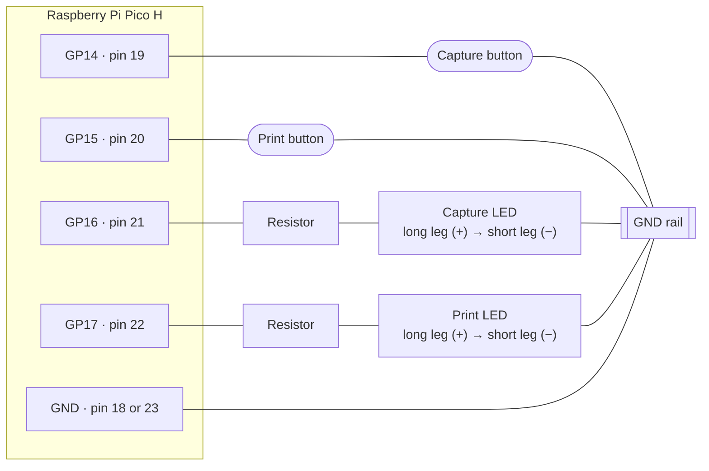

# pibooth-pico

Physical buttons and LEDs for [pibooth](https://github.com/pibooth/pibooth) on any PC
(e.g. Ubuntu on a regular computer), using a Raspberry Pi Pico running MicroPython
as a USB GPIO bridge.

## How it works

When pibooth runs on a machine without GPIO, it creates its buttons and LEDs on
simulated pins (gpiozero `MockFactory`). The `pibooth_pico.py` plugin:

- **Buttons:** when the Pico reports a press, the plugin "presses" the matching
  simulated pin. All of pibooth's native button logic keeps working
  (`debounce_delay`, both buttons to open the settings menu, menu navigation,
  left/right choice).
- **LEDs:** the plugin reads the state of the simulated LEDs (blinking included)
  and mirrors it to the real LEDs wired to the Pico.

If the Pico is unplugged, the plugin retries every 2 s and releases both buttons
so none stays stuck "pressed".

### Serial protocol

ASCII lines terminated by `\n`:

| Direction | Message | Meaning |
|---|---|---|
| Pico → PC | `C1` / `C0` | capture button pressed / released |
| Pico → PC | `P1` / `P0` | print button pressed / released |
| PC → Pico | `Lxy` | x = capture LED, y = print LED (`0`/`1`) |
| PC → Pico | `?` | Pico replies with the current state of both buttons |
| PC → Pico | `PING` | Pico replies `PONG` |

## 1. Wiring



| Function      | GPIO | Physical pin | Connection                          |
|---------------|------|--------------|-------------------------------------|
| Capture button| GP14 | 19           | GP14 → button → GND                 |
| Print button  | GP15 | 20           | GP15 → button → GND                 |
| Capture LED   | GP16 | 21           | GP16 → resistor → LED → GND         |
| Print LED     | GP17 | 22           | GP17 → resistor → LED → GND         |

Internal pull-ups are enabled, so the buttons need no external resistor.
Pin numbers are configurable at the top of `pico/main.py`.

### Choosing the LED resistor

The Pico outputs 3.3 V. The resistor limits the current according to the
LED's forward voltage, which depends on its colour:

| LED colour               | Forward voltage | Resistor | Current  |
|--------------------------|-----------------|----------|----------|
| Red, yellow, green       | ~2 V            | 220 Ω    | ~6 mA    |
| Blue, white, pure green  | ~3 V            | 100 Ω    | ~3 mA    |

With 100 Ω, a red LED would draw about 13 mA, which is more than the 4 mA a
Pico pin is rated for by default. It usually still works, but 220 Ω is safer
and the LED stays bright. Arcade buttons with a built-in LED often already
include a resistor: check their datasheet. LEDs rated for 5 V or 12 V will be
dim or stay off at 3.3 V.

Common pitfalls:

- **GPIO number ≠ physical pin number.** GP14 is physical pin 19. On the Pico H,
  pin numbers are printed on the underside; pin 1 is next to the USB connector.
- **4-leg tactile buttons:** legs are internally connected in pairs. Use two
  **diagonally opposite** legs, otherwise the button reads as always pressed.
- **LED polarity:** the long leg (+) goes to the resistor/GPIO side, the short leg
  (flat side) to GND.
- **Breadboard:** plug the Pico into the breadboard and wire into the same column
  as the pin, rather than pushing jumper wires into the Pico's header holes.

## 2. Pico firmware

```bash
pipx install mpremote
mpremote cp pico/main.py :main.py
mpremote reset
```

The Pico's onboard LED turns on when the firmware is running.

## 3. Ubuntu: serial port access

```bash
sudo cp 99-pibooth-pico.rules /etc/udev/rules.d/
sudo udevadm control --reload && sudo udevadm trigger
sudo usermod -aG dialout $USER   # then log out and back in
```

The rule creates `/dev/pibooth-pico` and stops ModemManager from probing the port.

Test it (press the buttons → `C1`/`C0`, `P1`/`P0`; type `L11` + Enter → both LEDs on):

```bash
pipx run --spec pyserial pyserial-miniterm /dev/pibooth-pico 115200 --echo --exit-char 24
```

Quit with `Ctrl-X`. On macOS there is no udev: use `/dev/cu.usbmodemXXXX` instead
(`ls /dev/cu.usbmodem*`).

Only one program can use the serial port at a time: close miniterm before starting
pibooth or using `mpremote`.

## 4. pibooth

```bash
python3 -m venv ~/pibooth-venv
~/pibooth-venv/bin/pip install pibooth pyserial
```

In `~/.config/pibooth/pibooth.cfg`:

```ini
[GENERAL]
plugins = /home/<user>/pibooth_pico.py

[PICO]
port = /dev/pibooth-pico
```

The `[CONTROLS]` options (`debounce_delay`, pin numbers) still apply. Pin numbers
are now only used for the simulated pins, so there is no need to change them.

## License

[MIT](LICENSE)
